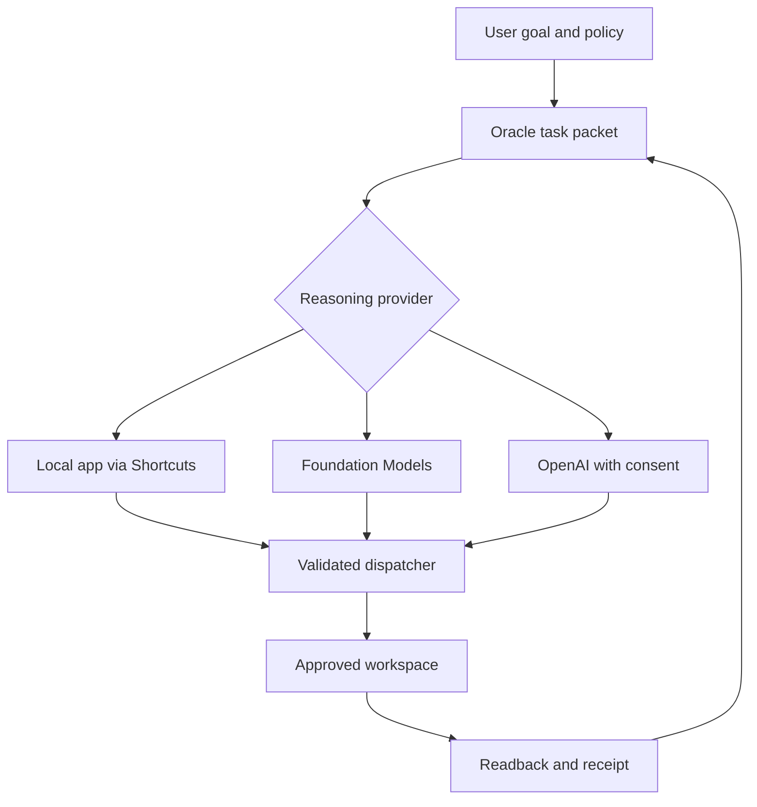

# Execution and evidence

The online control room and native sandbox have different authority. Web records belong to the authenticated Site user. Native files belong to the system-selected folder. Moving a file through an export is explicit; this build does not claim automatic iCloud or account synchronization.

## Web boundaries

`lib/server.ts` checks identity, origin, payload size, schemas, and cloud authorization at request boundaries. D1 queries are prepared statements scoped to the authenticated user ID. Files use compare-and-swap revisions. Settings use a workspace revision. Duplicate imported receipt IDs do not overwrite an existing receipt.

The browser stores no authoritative workspace data. Unsaved drafts live in React state. Failed saves preserve the draft and report the error. The file editor allows 64 KB text files and a 100-file workspace. The deterministic check uses a unique temporary file and stores its result before cleanup.

`/api/oracle` is a built-in task-packet compiler. Its output is labeled accordingly. `/api/step` is a configured OpenAI function-call relay and requires saved cloud consent. It does not execute the proposed device tools. It caps calls at 30 per authenticated user per hour. It has no public device-token or Apple-account endpoint; Shortcuts cannot bypass Sites sign-in to call it.

## Native boundaries

`SandboxStore` owns scoped folder bookmarks, path validation, symlink resolution, file coordination, size caps, atomic writes, and readback. A selected URL is never supplied by the model. Native model writes are limited to `workspace/` and `output/`; internal policy, checkpoint, and evidence files are written by the controller.

`Dispatcher` persists a pending call journal before a side effect. Reusing a completed call ID returns its recorded result if the call fingerprint matches. Pending calls cannot be replayed. Append and patch require the hash returned by a prior read, recheck it while coordinating the write, preserve a backup, and verify the saved content.

`AgentRunner` serializes execution, checkpoints before and after actions, records errors, requests cancellation when resource thresholds are crossed, and refuses a second concurrent run. It reports an evidence status only after recorded execution. It does not treat a model's `verified` field as authoritative.

A native verified receipt establishes tool execution/readback. It does not prove semantic completeness of an arbitrary user goal. A model may still misunderstand the goal. Device qualification and held-out task tests are required to characterize that quality.

## Providers

All model providers emit the same native action envelope. A tool action has `kind`, `tool`, and a string-valued `arguments` dictionary. The exact required arguments are defined by `ToolCall.validated()` in Models.swift. Hashes are required for native append/patch. A final action has `kind=final` and `summary`.

The native OpenAI adapter starts a fresh bounded Responses request each step, setting `store=false`. It wraps `propose_action` output into the native envelope. It intentionally does not retain a Responses continuation chain; latest tool evidence enters the next compact prompt. A Shortcut implementation that uses continuation must return the original call ID as `function_call_output`.

Siri launches exposed App Intents and named Shortcuts. Foundation Models is the callable Apple model provider. Apple’s system orchestrator performs cross-app routing; the app cannot invoke arbitrary other apps' intents directly.

## Optimization

Do not increase hardware authorization automatically. Measure exact model/runtime/device, policy, task family, verified outcomes, retries, context size, wall time, battery-level delta, and memory observation scope. Change one contract element per experiment. Keep failures and successful readback evidence. Compare task denominators; inference speed alone is not a quality result.

No always-on iOS background service is claimed. Work runs in foreground App Intents or explicit Shortcuts execution under iOS scheduling. Notifications are submitted to iOS; delivery remains subject to user settings.
